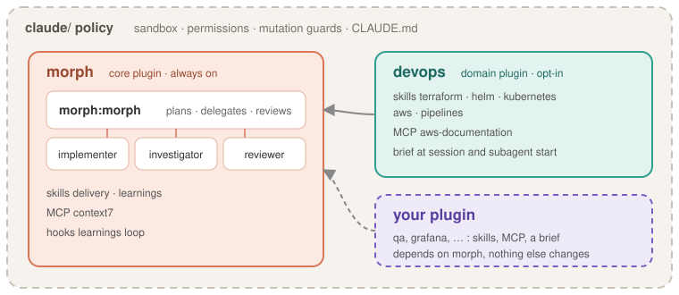

<p align="center"></p>

<h1 align="center">agent-config</h1>

<p align="center">An agent team for Claude Code that plans before it changes anything,<br>
and learns a domain from the plugins you switch on.</p>

## Install

```bash
git clone https://github.com/User-Piotr/agent-config.git ~/Repositories/agent-config
cd ~/Repositories/agent-config
cp .env.example .env      # optional: CONTEXT7_API_KEY
./install.sh
```

Restart Claude Code. Sessions start as **Morph**, the core agent.

Domain knowledge comes from plugins that are installed but off. Switch one on in
`/plugin` — `devops` for Terraform, Helm, Kubernetes and AWS — and it applies in
every repository, to Morph or any other agent. Switching it on changes one line
in `claude/settings.json`; commit that line to make it the default.

## What you get



| Part | What it does |
|---|---|
| **morph** (plugin, always on) | `morph:morph` plans, asks for approval, delegates, reviews. `implementer` writes the code, `investigator` reads and diagnoses, `reviewer` grades the diff. Skills for branches, commits and PRs, and for keeping `AGENTS.md` learnings. |
| **devops** (plugin, opt-in) | Terraform, Helm, Kubernetes, AWS and pipeline skills, the AWS docs server, and a short brief that tells every agent when to load them. |
| **claude/** (policy) | Sandbox, permissions, and guards that make every live change (`terraform apply`, `kubectl apply`, `git push`, …) ask first — and refuse it outright to subagents. |

## How a task goes

1. You ask. Morph reads the repo, then writes a plan to `.claude/plans/`.
2. You approve it. The implementer does the work and validates it (lint, dry-run, plan).
3. A reviewer checks shared changes. You get the exact commands for anything live.
4. When the session ends, anything worth remembering waits in `.claude/claude-md-review.md` for you to accept.

## Add your own domain

A domain is a plugin next to `devops`: skills, an MCP server, and a brief hook.
It depends on `morph` and changes nothing here. See
[docs/reference.md#your-own-plugin](docs/reference.md#your-own-plugin).

## More

- [docs/reference.md](docs/reference.md) — layout, settings, safety, updates, gateways and Bedrock
- [docs/graphify.md](docs/graphify.md) — the knowledge graph across repositories
- `bash claude/tests/guards.sh` — the guard test table
